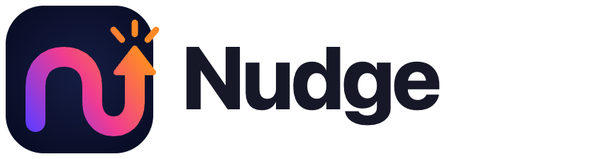

# Nudge 0.1.0-alpha.1

  <picture>
    <source media="(prefers-color-scheme: dark)" srcset="../../assets/brand/png/nudge-logo-on-dark.png">
    
  </picture>

Public alpha candidate for review. This file is the draft GitHub release description. Do not publish it until the maintainer accepts the candidate.

## Summary

Nudge is an open-source Chrome companion that follows text, dictation, and voice instructions on websites. This alpha runs from an unpacked extension plus a Fastify server on `127.0.0.1:4317`.

The archive is not a Chrome Web Store package. The extension ZIP is not enough on its own: the server has to be running, with the pairing secret that was compiled into that build.

## Included

- Browser tasks with confirmation, stop, and local history.
- Full-page chat, profile facts, and document upload in local SQLite.
- OpenAI API and Ollama.
- Optional local voice. OpenAI voice remains API-billed.
- Optional ChatGPT plan connection using the documented local open-source Sign in with ChatGPT flow. Preview limits apply. Not for a paid or hosted product.

## Not included

- Hosted accounts, a store listing, or remote analytics.
- A promise of correct behavior on every website.

## Install

Follow the Quick start in the repository README. Load the unpacked directory, or the unzipped `nudge-chrome-0.1.0-alpha.1` folder from the release asset, in `chrome://extensions`. Point `.env` at the pairing secret shipped beside that build, then start the server from a matching source checkout.

## Demo

No product recording is checked in. Use [demo-script.md](demo-script.md) on the fixture site.

## License

[MIT](../../LICENSE). Copyright (c) 2026 Nudge by AroicX Labs Ltd. Security and conduct reports: aroicx@gmail.com.
